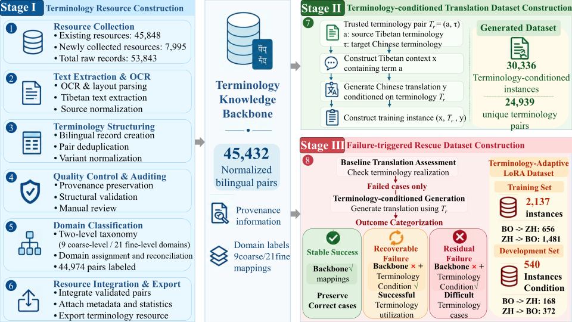

# BATA: Behavior-Aware Terminology Adaptation

Code for terminology-aware, low-resource Tibetan–Chinese machine translation. This release preserves the implementation associated with the final paper-mainline experiments; it does not include model checkpoints, adapters, corpora, terminology databases, or evaluation examples.

## Project overview

Tibetan–Chinese translation systems can produce fluent sentence-level translations while omitting or inconsistently translating domain terminology. Continued full-model fine-tuning on a small terminology corpus can also disturb general translation behavior. BATA (Behavior-Aware Terminology Adaptation) addresses terminology use by organizing terminology-conditioned examples according to the behavior of a task-adapted backbone and training separate lightweight adapters for the two translation directions.

The TC-Backbone used by the experiments is a task-specific, bidirectional Hy-MT2-7B checkpoint obtained by full-parameter supervised fine-tuning. The checkpoint is an external prerequisite and is not distributed here. The checked project audit records checkpoint step 200,000, but the original run YAML and exact backbone-training data manifest were not retained. The repository therefore does not claim to reproduce TC-Backbone training.

## Method overview

The behavior labels used in the manuscript are:

- **Stable Success**: the backbone already realizes the target terminology without an explicit term prompt.
- **Recoverable Failure**: the unconditioned output misses the term, while terminology conditioning enables the correct realization.
- **Residual Failure**: terminology conditioning still does not yield the target realization.

The retained v5 builder reads precomputed candidate pools and emits `preservation`, `rescue`, and `prompt_rescuable` examples. These correspond to the stable-success and recoverable subsets used by training; residual failures are analyzed as failures, not emitted as positive supervised examples by this builder. The candidate-pool generation stages that feed the builder are not included.

Two independent LoRA adapters are trained: BO→ZH and ZH→BO. At inference, source-only retrieval uses the matching direction’s terminology index. The released final policy is deterministic **top-1**, not top-3: among exact source-side matches, the ranking implementation resolves overlaps and blocks ambiguous or bidirectional-conflict candidates. A retrieved term is added to the prompt and activates that direction’s adapter; a non-hit uses the TC-Backbone without a terminology adapter. This is prompt-conditioned adapter routing, not constrained decoding.

## Visual overview

The three figures below are the figures used in the final paper. They are the original paper artwork converted from PDF to SVG, not redrawn illustrations.

<p align="center">
  
  <br />
  <sub><strong>Figure 1.</strong> Terminology resource construction, terminology-conditioned sentence construction, and behavior-aware adaptation-data construction.</sub>
</p>

<p align="center">
  
  <br />
  <sub><strong>Figure 2.</strong> Two-level domain distribution: the inner ring shows the nine first-level domains and the outer ring shows the 21 second-level categories.</sub>
</p>

<p align="center">
  
  <br />
  <sub><strong>Figure 3.</strong> Overview of BATA, combining direction-aware terminology retrieval, the TC-Backbone, and behavior-aware direction-specific LoRA adaptation.</sub>
</p>

### Supplementary experimental visualizations

These two plots provide visual summaries of results reported in the paper. They are supplementary views; the numerical tables below are the authoritative record.

<table>
  <tr>
    <td align="center" width="66%">
      
    </td>
    <td align="center" width="34%">
      
    </td>
  </tr>
  <tr>
    <td align="center" valign="top">
      <sub><strong>Supplementary Figure A.</strong> Oracle terminology utilization under Final2000.</sub>
    </td>
    <td align="center" valign="top">
      <sub><strong>Supplementary Figure B.</strong> Retrieval-assisted terminology utilization and translation quality (normalized axes).</sub>
    </td>
  </tr>
</table>

### Terminology resource summary

| Item | Count |
|---|---:|
| Raw terminology records | 53,843 |
| Existing-source records | 45,848 |
| Self-collected records | 7,995 |
| Unique normalized bilingual pairs | 45,432 |
| Pairs with resolved domain labels | 44,974 (98.99%) |
| Domain taxonomy | 9 first-level / 21 second-level categories |

## Experimental results

The supplementary plots in the visual gallery summarize the oracle-terminology and retrieval-assisted results. The numerical tables below are transcribed from the final `10_27.tex` manuscript and should be treated as the authoritative values.

### Oracle terminology utilization

| Direction | Method | Strict TermAcc | Canonical TermAcc | BLEU | chrF++ | ROUGE-L |
|---|---|---:|---:|---:|---:|---:|
| BO→ZH | TC-Backbone | 30.70 | 30.70 | 15.38 | 19.20 | 43.67 |
| BO→ZH | Prompt Conditioning | 89.15 | 89.15 | 15.13 | 20.43 | 41.65 |
| BO→ZH | BATA | **91.25** | **91.25** | **20.74** | **24.73** | **52.53** |
| ZH→BO | TC-Backbone | 3.40 | 15.80 | 21.35 | 43.63 | 50.00 |
| ZH→BO | Prompt Conditioning | 34.80 | 56.50 | 16.91 | 38.68 | 39.87 |
| ZH→BO | BATA | **83.30** | **97.35** | **35.16** | **53.11** | **63.63** |

### Retrieval-assisted translation

**Terminology retrieval performance**

| Direction | HIT Rate | Exact Agr. | Canonical Agr. |
|---|---:|---:|---:|
| BO→ZH | 99.65 | 75.50 | 75.50 |
| ZH→BO | 99.90 | 6.80 | 80.55 |
| Overall | 99.78 | 41.15 | 78.03 |

**End-to-end translation with and without retrieval**

| Direction | Setting | Strict TermAcc | Canonical TermAcc | BLEU | chrF++ | ROUGE-L |
|---|---|---:|---:|---:|---:|---:|
| BO→ZH | BATA without retrieval | 30.90 | 30.90 | 16.1910 | 19.9250 | 44.9180 |
| BO→ZH | BATA with retrieval | 75.70 | 75.70 | 19.4271 | 23.3313 | 50.2646 |
| ZH→BO | BATA without retrieval | 5.65 | 17.15 | 23.2550 | 43.7770 | 52.3720 |
| ZH→BO | BATA with retrieval | 45.75 | 82.15 | 32.6880 | 51.1507 | 61.3549 |

### Budget-matched comparison

Under matched training-example counts and optimizer updates, BATA improves Strict TermAcc over Random LoRA by **4.50 percentage points** for BO→ZH and **48.95 percentage points** for ZH→BO. Corpus BLEU improves by **1.76** and **3.87** points, respectively.

| Direction | Method | Training examples | Updates | Strict TermAcc | Corpus BLEU |
|---|---|---:|---:|---:|---:|
| BO→ZH | Random LoRA | 656 | 82 | 86.75 | 32.77 |
| BO→ZH | BATA | 656 | 82 | **91.25** | **34.52** |
| ZH→BO | Random LoRA | 1,481 | 186 | 34.35 | 33.61 |
| ZH→BO | BATA | 1,481 | 186 | **83.30** | **37.48** |

### General translation quality

The table reports changes in general-translation metrics when retrieval-routed BATA is used instead of TC-Backbone. Adapter activation is high on these benchmarks, but the metric changes are dataset- and direction-dependent.

| Dataset | Direction | Adapter activation | ΔBLEU | ΔchrF++ | ΔROUGE-L |
|---|---|---:|---:|---:|---:|
| FLORES-200 | BO→ZH | 100.00% | -0.36 | -0.31 | -0.75 |
| FLORES-200 | ZH→BO | 99.95% | +0.12 | -0.81 | +0.18 |
| MiLiC-Eval | BO→ZH | 99.24% | -0.96 | -0.75 | -1.18 |
| MiLiC-Eval | ZH→BO | 96.78% | -3.05 | -2.37 | -2.08 |
| mitra-parallel | ZH→BO | 67.35% | -0.57 | -0.99 | -1.01 |
| Ti-ChTrans | BO→ZH | 98.20% | -2.85 | -2.47 | -2.85 |

## Additional tables from the final manuscript

The following collapsible sections provide the detailed tables from the final manuscript that are useful for understanding the data resources, backbone adaptation, ablations, and evaluation controls without making the main README excessively long.

<details>
<summary><strong>Terminology sources and two-level domain taxonomy</strong></summary>

**Source composition before normalization and cross-source consolidation**

| Source | Type | Raw records |
|---|---|---:|
| Modern Tibetan Comparative Dictionary | Existing | 30,387 |
| CCMT2018-derived terminology | Existing | 15,461 |
| Historical project terminology | Self-collected | 579 |
| 2024 Tibetan New Terms | Self-collected | 52 |
| Classification and Codes of Tibetan Medical Diseases | Self-collected | 3,066 |
| Tibetan New Terms since the 19th CPC National Congress | Self-collected | 1,797 |
| 23rd National Tibetan-language Media Cooperation Conference | Self-collected | 234 |
| Chinese–Tibetan Reference Dictionary of Tourist Attractions | Self-collected | 260 |
| Tibetan Vocabulary for Information Technology | Self-collected | 2,007 |
| **Existing subtotal** |  | **45,848** |
| **Self-collected subtotal** |  | **7,995** |
| **Total raw records** |  | **53,843** |

**Two-level domain taxonomy**

| First-level domain | Second-level category | Pairs |
|---|---|---:|
| Politics, Law and Public Security | Political and Public Administration | 1,525 |
|  | Law and Justice | 1,041 |
|  | Military and Security | 967 |
| Economy, Finance and Commerce | Finance and Economics | 1,333 |
|  | Commerce, Services and Consumption | 1,180 |
| Engineering, Construction and Transportation | Engineering Technology and Power | 1,709 |
|  | Architecture and Real Estate | 592 |
|  | Transportation and Aviation | 819 |
| Agriculture, Food and Environment | Agriculture, Forestry, Animal Husbandry and Fisheries | 1,442 |
|  | Food and Catering | 1,077 |
|  | Environment and Energy | 818 |
| Education, Culture, Religion and Media | Education and Training | 1,309 |
|  | Culture, Arts, Media and Publishing | 2,417 |
|  | Religion and Philosophy | 650 |
| Information Technology and Internet | Information Technology and Internet | 2,536 |
| Healthcare and Life Sciences | Healthcare | 5,477 |
| Sports, Tourism and Leisure Geography | Sports | 629 |
|  | Tourism Geography and Place Names | 1,230 |
| Social Life and Named Entities | Social Life and General Concepts | 12,993 |
|  | Everyday and General Expressions | 4,252 |
|  | Person, Place and Other Proper Names | 978 |
| **Resolved total** | **9 first-level / 21 second-level categories** | **44,974** |

</details>

<details>
<summary><strong>TC-Backbone quality comparison</strong></summary>

Translation quality of Hy-MT2-7B and the task-adapted TC-Backbone. Values are BLEU / chrF++ / ROUGE-L.

| Dataset | Direction | Hy-MT2-7B | TC-Backbone |
|---|---|---:|---:|
| FLORES-200 | BO→ZH | 11.08 / 15.88 / 38.01 | **11.24 / 15.98 / 38.01** |
| FLORES-200 | ZH→BO | 7.61 / 33.03 / 27.58 | **8.64** / 32.35 / **29.06** |
| FLORES-200 | BO→EN | 11.81 / 40.32 / 35.26 | 11.21 / 37.35 / 32.59 |
| FLORES-200 | EN→BO | 8.24 / 32.31 / 29.46 | **9.04** / 31.94 / **30.69** |
| MiLiC-Eval | BO→ZH | 19.58 / 23.19 / 48.06 | **22.05 / 25.23 / 50.17** |
| MiLiC-Eval | ZH→BO | 19.60 / 40.76 / 42.72 | **26.87 / 44.13 / 48.08** |
| mitra-parallel | ZH→BO | 3.90 / 21.02 / 16.08 | **11.62 / 30.13 / 31.10** |
| mitra-parallel | BO→EN | 6.33 / 25.90 / 20.33 | 5.99 / 21.59 / 19.63 |
| mitra-parallel | BO→LZH | 4.11 / 5.15 / 15.80 | **5.18 / 6.61 / 16.95** |
| mitra-parallel | EN→BO | 4.48 / 23.90 / 19.23 | **9.03 / 28.71 / 27.53** |
| mitra-parallel | LZH→BO | 3.85 / 21.37 / 16.08 | **14.99 / 34.29 / 36.10** |
| Ti-ChTrans | BO→ZH | 27.24 / 30.34 / 57.05 | **31.48 / 33.80 / 59.45** |
| ZangHan_General | BO→ZH | 19.73 / 22.24 / 45.85 | **27.35 / 30.23 / 53.26** |
| ZangHan_General | ZH→BO | 20.14 / 40.38 / 45.43 | **28.26 / 45.93 / 54.02** |
| YingZang | BO→EN | 19.99 / 44.16 / 41.37 | **30.89 / 53.24 / 51.85** |
| YingZang | EN→BO | 16.17 / 37.01 / 40.64 | **27.65 / 45.55 / 53.07** |
| GuHanZang | BO→LZH | 2.14 / 5.20 / 15.67 | **12.49 / 18.14 / 37.06** |
| GuHanZang | LZH→BO | 2.93 / 26.00 / 18.98 | **24.48 / 42.54 / 48.86** |

</details>

<details>
<summary><strong>Direction-specific LoRA and behavior-data ablations</strong></summary>

**Direction-specific versus shared LoRA under oracle terminology**

| Direction | Adapter | Strict TermAcc | Canonical TermAcc | Sentence BLEU | Corpus BLEU |
|---|---|---:|---:|---:|---:|
| BO→ZH | BATA (directional, r=8) | 91.25 | 91.25 | 20.74 | 34.52 |
| BO→ZH | Joint (r=8) | 83.40 | 87.20 | 18.62 | — |
| BO→ZH | Joint (r=16) | 95.30 | 95.30 | 23.09 | 36.78 |
| ZH→BO | BATA (directional, r=8) | 83.30 | 97.35 | 35.16 | 37.48 |
| ZH→BO | Joint (r=8) | 66.35 | 91.20 | 30.21 | — |
| ZH→BO | Joint (r=16) | 37.25 | 94.85 | 34.08 | 34.17 |

**Behavior-aware training-data composition**

| Direction | Training data | Strict TermAcc | Canonical TermAcc | BLEU | chrF++ | ROUGE-L |
|---|---|---:|---:|---:|---:|---:|
| BO→ZH | Correction-only | 87.40 | 87.40 | 18.82 | 23.05 | 49.28 |
| BO→ZH | Correction + Preservation | 88.40 | 88.40 | 19.97 | 24.03 | 51.48 |
| BO→ZH | Full behavior-aware | **91.25** | **91.25** | **20.74** | **24.73** | **52.53** |
| ZH→BO | Correction-only | 52.50 | 96.60 | 33.43 | 52.41 | 62.57 |
| ZH→BO | Correction + Preservation | 67.75 | 97.15 | 34.07 | 52.54 | 62.80 |
| ZH→BO | Full behavior-aware | **83.30** | **97.35** | **35.16** | **53.11** | **63.63** |

**Training-budget comparison including the all-data LoRA control**

| Direction | Adapter | Train examples | Updates | Strict / Canonical TermAcc | Sentence BLEU | Corpus BLEU | chrF++ / ROUGE-L |
|---|---|---:|---:|---:|---:|---:|---:|
| BO→ZH | Random LoRA | 656 | 82 | 86.75 / 86.75 | 19.51 | 32.77 | 23.57 / 50.66 |
| BO→ZH | BATA | 656 | 82 | **91.25 / 91.25** | **20.74** | **34.52** | **24.73 / 52.53** |
| BO→ZH | All-Data LoRA | 23,067 | 2,884 | 95.00 / 95.00 | 25.84 | 38.47 | 28.56 / 58.22 |
| ZH→BO | Random LoRA | 1,481 | 186 | 34.35 / 94.80 | 33.90 | 33.61 | 52.60 / 62.80 |
| ZH→BO | BATA | 1,481 | 186 | **83.30 / 97.35** | **35.16** | **37.48** | **53.11 / 63.63** |
| ZH→BO | All-Data LoRA | 23,067 | 2,884 | 80.75 / 97.20 | 39.17 | 43.09 | 54.82 / 67.44 |

</details>

<details>
<summary><strong>Bootstrap intervals, few-shot controls, and E5 routing</strong></summary>

**Paired bootstrap intervals**

The intervals below use 5,000 resamples of matched test records. They characterize test-sample uncertainty within a single training run per system.

| Direction | Comparison (BATA minus) | Strict TermAcc Δ (pp), 95% CI | Sentence BLEU Δ, 95% CI |
|---|---|---:|---:|
| BO→ZH | Random LoRA | +4.50 [3.50, 5.50] | +1.236 [0.899, 1.584] |
| BO→ZH | All-Data LoRA | −3.75 [−4.95, −2.55] | −5.096 [−5.907, −4.251] |
| BO→ZH | Capacity-matched Joint | −4.05 [−5.00, −3.10] | −2.349 [−2.832, −1.855] |
| ZH→BO | Random LoRA | +48.95 [46.80, 51.15] | +1.265 [0.816, 1.715] |
| ZH→BO | All-Data LoRA | +2.55 [0.80, 4.30] | −4.007 [−4.776, −3.232] |
| ZH→BO | Capacity-matched Joint | +46.05 [43.85, 48.15] | +1.088 [0.657, 1.562] |

**Non-adaptation baselines with oracle terminology**

| Direction | Method | Strict / Canonical TermAcc | Sentence BLEU | Corpus BLEU | chrF++ | ROUGE-L |
|---|---|---:|---:|---:|---:|---:|
| BO→ZH | 1-shot prompting | 89.85 / 89.85 | 15.17 | 18.15 | 19.87 | 41.06 |
| BO→ZH | 3-shot prompting | 86.60 / 86.60 | 19.05 | 27.79 | 23.06 | 50.06 |
| BO→ZH | Lexical-regex decoding | 90.20 / 90.20 | 13.93 | 2.12 | 18.99 | 37.96 |
| ZH→BO | 1-shot prompting | 42.85 / 87.60 | 21.98 | 22.52 | 41.67 | 46.23 |
| ZH→BO | 3-shot prompting | 42.10 / 91.55 | 24.30 | 23.97 | 44.01 | 49.97 |
| ZH→BO | Lexical-regex decoding | 41.25 / 60.50 | 8.26 | 1.74 | 21.95 | 19.71 |

**Backbone-aware E5 routing on general translation benchmarks**

| Benchmark | Direction | n | Original activation | E5 activation | Backbone sentence BLEU | E5 sentence BLEU |
|---|---|---:|---:|---:|---:|---:|
| FLORES-200 | BO→ZH | 2,009 | 100.00% | 74.76% | 11.24 | 10.95 |
| FLORES-200 | ZH→BO | 2,009 | 99.95% | 64.16% | 8.64 | 8.55 |
| MiLiC-Eval | BO→ZH | 1,585 | 99.24% | 76.47% | 22.05 | 21.14 |
| MiLiC-Eval | ZH→BO | 1,585 | 96.78% | 62.59% | 26.87 | 24.14 |
| mitra-parallel | LZH→BO | 2,499 | — | 49.02% | 11.62 | 11.28 |
| Ti-ChTrans | BO→ZH | 1,000 | 98.20% | 71.50% | 31.48 | 29.02 |

</details>

## Project structure

```text
BATA/
├── README.md
├── assets/
│   ├── figure1_data_construction.svg
│   ├── figure2_domain_distribution.svg
│   ├── figure3_bata_framework.svg
│   ├── oracle_adaptation_results.webp
│   └── retrieval_effect_radar.webp
├── requirements.txt
├── .gitignore
├── configs/
│   ├── training_bo2zh.json
│   ├── training_zh2bo.json
│   ├── retrieval_policy_v1.json
│   └── frozen_ranking_policy_v2.json
├── tests/
└── terminology_v2/
    ├── stage1_behavior_dataset_v5/build_behavior_dataset_v5.py
    ├── stage2_lora_training_v1/train_direction.py
    ├── rag_integration_v1/
    │   ├── src/                         # exact terminology index/retrieval
    │   ├── config/retrieval_policy_v1.json
    │   └── ranking_v2/src/              # candidate ranking and frozen policy
    ├── rag_lora_final2000/src/           # preflight, prompts, inference, scoring
    └── unified_quality_evaluation_v1/    # BLEU, chrF++, ROUGE-L and term metrics
```

## Environment setup

The recorded LoRA training environment is Python 3.10.20, PyTorch 2.6.0+cu124, Transformers 5.14.1, PEFT 0.18.0, and Accelerate 1.14.0. The retrieval/index and prompt-construction modules otherwise use the Python standard library. Evaluation additionally imports `jieba`, `rouge-score`, and `sacrebleu`; their exact installed versions were not retained.

```bash
python3.10 -m venv .venv
source .venv/bin/activate
python -m pip install --upgrade pip
python -m pip install --index-url https://download.pytorch.org/whl/cu124 'torch==2.6.0+cu124'
python -m pip install -r requirements.txt
```

GPU training requires a CUDA-capable PyTorch installation. `run_inference.py` imports vLLM; the exact vLLM release used for the paper-mainline run is not recorded in its retained metadata, so this project intentionally does not pin one. Install and validate a vLLM build compatible with the selected PyTorch/CUDA stack and the Hy-MT2 model implementation before inference.

LLaMA-Factory was used for the upstream full-parameter TC-Backbone SFT, not for the retained BATA LoRA training script. The TC-Backbone launcher, exact run configuration, and dataset manifest are outside this release. BATA adapters are trained directly with Transformers and PEFT.

## Data preparation

No source corpora, terminology lists, or evaluation references are redistributed. Supply authorized local copies and configure these paths:

1. `BATA_TERMINOLOGY_ROOT`: the local `terminology_v2` directory (defaults to the directory containing this release’s stage folders).
2. `BATA_BASE_MODEL`: local TC-Backbone checkpoint directory.
3. `BATA_TERMINOLOGY_ENTRIES` and `BATA_TERMINOLOGY_ALIASES`: bilingual KB JSONL files (default to `terminology_entries.jsonl` and `terminology_aliases.jsonl` under `BATA_TERMINOLOGY_ROOT`).
4. `BATA_PROJECT_ROOT`: project data root (defaults to the parent of `BATA_TERMINOLOGY_ROOT`).
5. `BATA_FINAL_DATA_DIR`: evaluation JSONL directory (defaults to `$BATA_PROJECT_ROOT/data/final2000`). The expected files are `bo2zh_final2000.jsonl` and `zh2bo_final2000.jsonl`.
6. For behavior-data construction, provide the upstream candidate files under `stage1_step15_rebuild_bo2zh_v1/` and `stage1_reverse_candidate_mining_zh2bo_v1/`: each direction requires `hard_pool.jsonl`, `prompt_rescuable.jsonl`, and `preservation.jsonl`. Those upstream candidate-generation stages are not included, so a fresh user cannot rebuild the behavior dataset from raw corpora using this repository alone.
7. For frozen R5 ranking, provide the Behavior-v5 dev JSONL files, the independent stability-dev JSONL (`BATA_STABILITY_DEV_FILE`), and the Final2000 records. Retrieval and adapter outputs are generated locally.

Training records are JSONL objects with `messages` in system/user/assistant order plus `record_id`, direction, source/reference, bilingual term fields, and terminology ID. The builder creates direction-specific `train.jsonl` and `dev.jsonl` splits at terminology-ID level. Do not put evaluation references into runtime retriever inputs; retrieval accepts only `record_id`, `direction`, and `source`.

## Model training

Set the model and data roots, then build the behavior dataset if the required candidate pools are available:

```bash
export BATA_TERMINOLOGY_ROOT="$PWD/terminology_v2"
export BATA_PROJECT_ROOT="$PWD"
export BATA_BASE_MODEL="/path/to/local/TC-Backbone"
python terminology_v2/stage1_behavior_dataset_v5/build_behavior_dataset_v5.py
```

Train one direction at a time; the script accepts `bo2zh` or `zh2bo` and writes the adapter and run metadata under `stage2_lora_training_v1/<direction>/`:

```bash
python terminology_v2/stage2_lora_training_v1/train_direction.py --direction bo2zh
python terminology_v2/stage2_lora_training_v1/train_direction.py --direction zh2bo
```

The retained settings are rank/alpha 8/8, dropout 0.1, seven attention/MLP projection modules, one epoch, micro-batch 1, gradient accumulation 8, sequence limit 512, AdamW at `1e-5`, FP16, and seed 20260811. The shipped JSON config files document these settings; the training script remains the executable source of truth. No training is run by installation or test commands.

## Terminology retrieval

`terminology_v2/rag_integration_v1/src/current_kb_exact_retriever.py` builds a bilingual exact-span index from the current KB. Tibetan matching considers canonical/observed forms and aliases; Chinese matching uses exact source terms. `AMBIGUOUS_MATCH` and bidirectional conflicts are not treated as hits. `ranking_v2/src/ranking_candidates.py` and `build_ranking_v2.py` implement and evaluate the deterministic ranking policies; the retained frozen policy selects one candidate (top-1). The selection script needs the external KB, dev, and Final2000 inputs described above. It is not an online service and has no network dependency.

```bash
python terminology_v2/rag_integration_v1/src/build_and_evaluate.py
python terminology_v2/rag_integration_v1/ranking_v2/src/build_ranking_v2.py
```

The first command writes a current-KB exact index and retrieval audit; the second uses development data to select/freeze a policy and writes Final2000 retrieval records. These commands require the external inputs and are not expected to run on a checkout without local data.

## Inference

Inference requires a local TC-Backbone, both direction-specific adapters, aligned Final2000 JSONL, and frozen R5 retrieval JSONL. The preflight checks all three resources and prompt/reference isolation before loading a model. It produces a local preflight report; inference refuses to run unless that report passes.

```bash
export BATA_TERMINOLOGY_ROOT="$PWD/terminology_v2"
export BATA_PROJECT_ROOT="$PWD"
export BATA_BASE_MODEL="/path/to/local/TC-Backbone"
export BATA_FINAL_DATA_DIR="$PWD/data/final2000"
export BATA_RETRIEVAL_DIR="$PWD/terminology_v2/rag_integration_v1/ranking_v2/retrieval"
python terminology_v2/rag_lora_final2000/src/verify_alignment.py
python terminology_v2/rag_lora_final2000/src/run_inference.py --direction bo2zh --batch-size 32
python terminology_v2/rag_lora_final2000/src/run_inference.py --direction zh2bo --batch-size 32
```

On a retrieval hit, the inference runner supplies the retrieved term pair and loads the adapter for that direction. On a no-hit, ambiguous, or blocked record it generates with the backbone only. The default outputs are local prediction JSONL files; use `--output` and `--run-report` to choose other paths. Do not point outputs at a directory containing results you need to preserve.

## Evaluation

The unified evaluator reports sentence-level BLEU, chrF++, ROUGE-L, Strict TermAcc, and Canonical TermAcc. Chinese BLEU tokenization uses Jieba; Tibetan tokenization splits Tibetan separators/whitespace. The Final2000 evaluator requires the matching reference JSONL and checks sample order before scoring.

```bash
python terminology_v2/rag_lora_final2000/src/evaluate.py --direction bo2zh
python terminology_v2/rag_lora_final2000/src/evaluate.py --direction zh2bo
python terminology_v2/rag_lora_final2000/src/build_summary.py
```

`evaluate.py` accepts `--predictions` and `--output` overrides. The underlying read-only metric implementation is in `terminology_v2/unified_quality_evaluation_v1/unified_evaluator.py`.

## Tests

The lightweight tests cover exact retrieval, ranking, prompt/schema alignment, and metric behavior; they do not load a model or use a GPU. From the repository root:

```bash
PYTHONPATH=terminology_v2/rag_integration_v1/src:terminology_v2/rag_integration_v1/ranking_v2/src:terminology_v2/rag_lora_final2000/src:terminology_v2/unified_quality_evaluation_v1 python -m unittest discover -s tests -v
```

## Known limitations

- Model checkpoints, LoRA adapter weights, training/evaluation datasets, bilingual terminology KB files, retrieval outputs, caches, and logs are not distributed.
- The upstream candidate-pool construction stages and the original TC-Backbone full-SFT configuration/data manifest are not included; fresh end-to-end reproduction needs those artifacts from the authors.
- The project’s frozen final retrieval behavior is top-1, although an earlier manuscript version describes selecting up to three terms. This release documents the code that generated the final audited results; it does not implement top-3 selection.
- `BATA_BASE_MODEL` and all data locations must be set on the user’s machine. Model compatibility and GPU requirements have not been validated on arbitrary environments.

## Citation

Zeshuo Liu, Jiu Sha, Yunhao Tian, Yu Weng, Zheng Liu, and Kailiang Wen. *BATA: Behavior-Aware Terminology Adaptation for Low-Resource Tibetan–Chinese Machine Translation.* Liu and Sha contributed equally; Yu Weng is the corresponding author.
