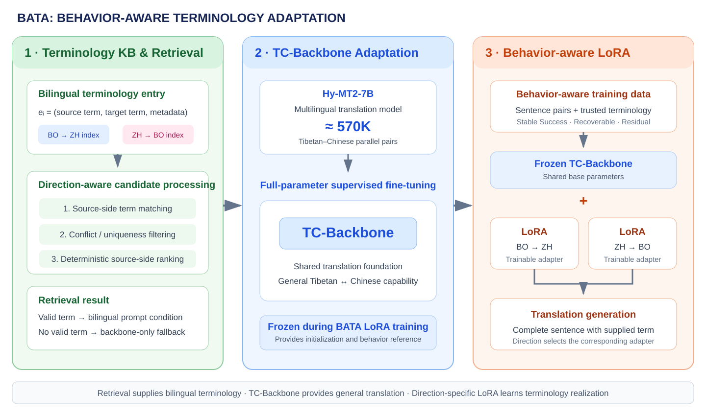

# BATA: Behavior-Aware Terminology Adaptation

**BATA** is a terminology adaptation framework for low-resource Tibetan–Chinese machine translation. It improves the use of domain-specific bilingual terminology by adapting a translation model according to its observed terminology behavior, rather than treating all terminology examples in the same way.

## Overview

A translation backbone may translate a sentence fluently but fail to produce a required technical term, even when the correct bilingual terminology is available. BATA addresses this problem in three steps:

1. **Build a Tibetan–Chinese translation backbone.** Hy-MT2-7B is adapted with approximately 570K Tibetan–Chinese parallel sentence pairs to obtain the TC-Backbone.
2. **Organize terminology examples by model behavior.** Examples are grouped as *Stable Success*, *Recoverable Failure*, or *Residual Failure*, according to whether the backbone realizes the target term with or without terminology conditioning.
3. **Train direction-specific LoRA adapters.** The TC-Backbone is kept frozen while separate adapters are trained for Tibetan-to-Chinese (BO→ZH) and Chinese-to-Tibetan (ZH→BO) translation.

At inference time, a direction-aware terminology retrieval module finds relevant bilingual terms in the source sentence, filters ambiguous mappings, and supplies valid terms as translation conditions. The corresponding direction-specific adapter is used when a term is retrieved; otherwise, translation falls back to the TC-Backbone.

## Method

<p align="center">
  
</p>
<p align="center"><sub>Overview of BATA: terminology retrieval, the TC-Backbone, and behavior-aware direction-specific LoRA adaptation.</sub></p>

The three behavior groups play different roles in adaptation:

- **Stable Success:** the backbone already produces the target terminology without an explicit term prompt.
- **Recoverable Failure:** the backbone misses the term, but can produce it when the bilingual term is supplied.
- **Residual Failure:** the target term is still not correctly realized after terminology conditioning.

The retrieval component uses direction-specific lexical matching and deterministic filtering. It is not semantic-vector retrieval or constrained decoding. The released final policy selects a single eligible candidate (top-1) and rejects unresolved ambiguous mappings.

## Terminology resource

The terminology resource contains **53,843 raw records**, consolidated into **45,432 unique normalized bilingual pairs**. Domain labels are resolved for **44,974 pairs (98.99%)**, using a taxonomy of nine first-level domains and 21 second-level categories.

<p align="center">
  
</p>
<p align="center"><sub>Terminology collection and normalization, terminology-conditioned sentence construction, and behavior-aware adaptation-data preparation.</sub></p>

The paper reports 30,366 terminology-conditioned sentence instances and 2,677 behavior-aware instances (2,137 for training and 540 for development). The domain distribution is summarized in the paper; see Figure 2 in the manuscript for the full taxonomy visualization.

## Main results

On the oracle-terminology evaluation, BATA obtains **91.25% Strict TermAcc** for BO→ZH and **83.30%** for ZH→BO. Compared with Random LoRA under matched training-example counts and optimizer updates, BATA improves Strict TermAcc by **4.50** and **48.95 percentage points**, and corpus BLEU by **1.76** and **3.87 points**, respectively.

Retrieval-based evaluation shows the benefit of automatically supplying terminology. The paper also reports a trade-off on general translation benchmarks: terminology-triggered adapter activation can affect general translation quality. See the paper for the complete evaluation, ablations, and analysis.

## Repository contents

```text
BATA/
├── README.md
├── assets/                 # Paper figures used in this README
├── configs/                # LoRA and retrieval/ranking configurations
├── requirements.txt
├── tests/                  # Retrieval, inference-pipeline, and metric tests
└── terminology_v2/
    ├── stage1_behavior_dataset_v5/   # Behavior-aware dataset builder
    ├── stage2_lora_training_v1/      # Direction-specific LoRA training
    ├── rag_integration_v1/            # Terminology indexing and retrieval
    ├── rag_lora_final2000/            # Prompting, inference, and evaluation
    └── unified_quality_evaluation_v1/ # Translation and terminology metrics
```

## Setup

The recorded LoRA training environment uses Python 3.10.20, PyTorch 2.6.0+cu124, Transformers 5.14.1, PEFT 0.18.0, and Accelerate 1.14.0.

```bash
python3.10 -m venv .venv
source .venv/bin/activate
python -m pip install --upgrade pip
python -m pip install --index-url https://download.pytorch.org/whl/cu124 'torch==2.6.0+cu124'
python -m pip install -r requirements.txt
```

Inference additionally requires a compatible vLLM installation. Its exact version in the paper-mainline run was not retained, so it is not pinned in this repository.

## Data and model requirements

This repository contains the implementation and configuration files, but does **not** distribute model checkpoints, LoRA adapter weights, source corpora, terminology databases, behavior/evaluation datasets, or generated retrieval results.

To run the full pipeline, prepare the following resources locally:

- The TC-Backbone checkpoint (initialized from Hy-MT2-7B and fine-tuned for Tibetan–Chinese translation).
- The bilingual terminology entries and aliases.
- The upstream candidate pools required by the behavior-dataset builder.
- The Final2000 evaluation records and the development/stability data required by retrieval-policy preparation.

The upstream candidate-pool generation stages and the original TC-Backbone training manifest are not included. Consequently, a fresh checkout cannot reproduce the complete data-construction pipeline from raw corpora alone.

## Training

Set the local paths first:

```bash
export BATA_TERMINOLOGY_ROOT="$PWD/terminology_v2"
export BATA_PROJECT_ROOT="$PWD"
export BATA_BASE_MODEL="/path/to/TC-Backbone"
```

Build the behavior-aware dataset (requires the upstream candidate pools described above), then train the adapters independently:

```bash
python terminology_v2/stage1_behavior_dataset_v5/build_behavior_dataset_v5.py

python terminology_v2/stage2_lora_training_v1/train_direction.py --direction bo2zh
python terminology_v2/stage2_lora_training_v1/train_direction.py --direction zh2bo
```

## Inference and evaluation

Inference requires the TC-Backbone, trained direction-specific adapters, Final2000 records, and the prepared retrieval outputs. Run the alignment/preflight check before generation:

```bash
python terminology_v2/rag_lora_final2000/src/verify_alignment.py

python terminology_v2/rag_lora_final2000/src/run_inference.py --direction bo2zh --batch-size 32
python terminology_v2/rag_lora_final2000/src/run_inference.py --direction zh2bo --batch-size 32
```

Evaluate the generated predictions:

```bash
python terminology_v2/rag_lora_final2000/src/evaluate.py --direction bo2zh
python terminology_v2/rag_lora_final2000/src/evaluate.py --direction zh2bo
python terminology_v2/rag_lora_final2000/src/build_summary.py
```

## Tests

The lightweight tests do not load model weights or require a GPU:

```bash
PYTHONPATH=terminology_v2/rag_integration_v1/src:terminology_v2/rag_integration_v1/ranking_v2/src:terminology_v2/rag_lora_final2000/src:terminology_v2/unified_quality_evaluation_v1 python -m unittest discover -s tests -v
```

## Citation

Zeshuo Liu, Jiu Sha, Yunhao Tian, Yu Weng, Zheng Liu, and Kailiang Wen. *BATA: Behavior-Aware Terminology Adaptation for Low-Resource Tibetan–Chinese Machine Translation.* Liu and Sha contributed equally; Yu Weng is the corresponding author.
