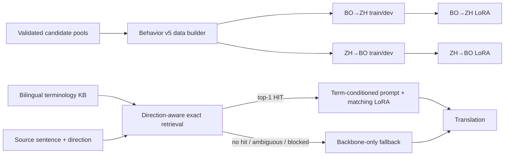

# BATA: Behavior-Aware Terminology Adaptation

Code for terminology-aware, low-resource Tibetan–Chinese machine translation. This release preserves the implementation associated with the project’s final paper-mainline assets; it does not include model checkpoints, adapters, corpora, terminology databases, or evaluation examples.

## Project overview

Tibetan–Chinese translation systems can produce fluent sentence-level translations while omitting or inconsistently translating domain terminology. Continued full-model fine-tuning on a small terminology corpus can also disturb general translation behavior. BATA (Behavior-Aware Terminology Adaptation) addresses terminology use by organizing terminology-conditioned examples according to the behavior of a task-adapted backbone and training separate lightweight adapters for the two translation directions.

The TC-Backbone used by the experiments is a task-specific, bidirectional Hy-MT2-7B checkpoint obtained by full-parameter supervised fine-tuning. The checkpoint is an external prerequisite and is not distributed here. The checked project audit records checkpoint step 200,000, but the original run YAML and exact backbone-training data manifest were not retained. The repository therefore does not claim to reproduce TC-Backbone training.

## Method overview

The behavior labels used in the manuscript are:

- **Stable Success**: the backbone already realizes the target terminology without an explicit term prompt.
- **Recoverable Failure**: the unconditioned output misses the term, while terminology conditioning enables the correct realization.
- **Residual Failure**: terminology conditioning still does not yield the target realization.

The retained v5 builder reads precomputed candidate pools and emits `preservation`, `rescue`, and `prompt_rescuable` examples. These correspond to the stable-success and recoverable subsets used by training; residual failures are analyzed as failures, not emitted as positive supervised examples by this builder. The candidate-pool generation stages that feed the builder are not included.

Two independent LoRA adapters are trained: BO→ZH and ZH→BO. At inference, source-only retrieval uses the matching direction’s terminology index. The released final policy is deterministic **top-1**, not top-3: among exact source-side matches, the ranking implementation resolves overlaps and blocks ambiguous or bidirectional-conflict candidates. A retrieved term is added to the prompt and activates that direction’s adapter; a non-hit uses the TC-Backbone without a terminology adapter. This is prompt-conditioned adapter routing, not constrained decoding.



## Project structure

```text
BATA/
├── README.md
├── requirements.txt
├── .gitignore
├── configs/
│   ├── training_bo2zh.json
│   ├── training_zh2bo.json
│   ├── retrieval_policy_v1.json
│   └── frozen_ranking_policy_v2.json
├── tests/
└── terminology_v2/
    ├── stage1_behavior_dataset_v5/build_behavior_dataset_v5.py
    ├── stage2_lora_training_v1/train_direction.py
    ├── rag_integration_v1/
    │   ├── src/                         # exact terminology index/retrieval
    │   ├── config/retrieval_policy_v1.json
    │   └── ranking_v2/src/              # candidate ranking and frozen policy
    ├── rag_lora_final2000/src/           # preflight, prompts, inference, scoring
    └── unified_quality_evaluation_v1/    # BLEU, chrF++, ROUGE-L and term metrics
```

Generated data, indexes, retrieval outputs, predictions, model weights, logs, and caches are deliberately excluded. Runtime files are written locally under the corresponding experiment directories.

## Environment setup

The recorded LoRA training environment is Python 3.10.20, PyTorch 2.6.0+cu124, Transformers 5.14.1, PEFT 0.18.0, and Accelerate 1.14.0. The retrieval/index and prompt-construction modules otherwise use the Python standard library. Evaluation additionally imports `jieba`, `rouge-score`, and `sacrebleu`; their exact installed versions were not retained.

```bash
python3.10 -m venv .venv
source .venv/bin/activate
python -m pip install --upgrade pip
python -m pip install --index-url https://download.pytorch.org/whl/cu124 'torch==2.6.0+cu124'
python -m pip install -r requirements.txt
```

GPU training requires a CUDA-capable PyTorch installation. `run_inference.py` imports vLLM; the exact vLLM release used for the paper-mainline run is not recorded in its retained metadata, so this project intentionally does not pin one. Install and validate a vLLM build compatible with the selected PyTorch/CUDA stack and the Hy-MT2 model implementation before inference.

LLaMA-Factory was used for the upstream full-parameter TC-Backbone SFT, not for the retained BATA LoRA training script. The TC-Backbone launcher, exact run configuration, and dataset manifest are outside this release. BATA adapters are trained directly with Transformers and PEFT.

## Data preparation

No source corpora, terminology lists, or evaluation references are redistributed. Supply authorized local copies and configure these paths:

1. `BATA_TERMINOLOGY_ROOT`: the local `terminology_v2` directory (defaults to the directory containing this release’s stage folders).
2. `BATA_BASE_MODEL`: local TC-Backbone checkpoint directory.
3. `BATA_TERMINOLOGY_ENTRIES` and `BATA_TERMINOLOGY_ALIASES`: bilingual KB JSONL files (default to `terminology_entries.jsonl` and `terminology_aliases.jsonl` under `BATA_TERMINOLOGY_ROOT`).
4. `BATA_PROJECT_ROOT`: project data root (defaults to the parent of `BATA_TERMINOLOGY_ROOT`).
5. `BATA_FINAL_DATA_DIR`: evaluation JSONL directory (defaults to `$BATA_PROJECT_ROOT/data/final2000`). The expected files are `bo2zh_final2000.jsonl` and `zh2bo_final2000.jsonl`.
6. For behavior-data construction, provide the upstream candidate files under `stage1_step15_rebuild_bo2zh_v1/` and `stage1_reverse_candidate_mining_zh2bo_v1/`: each direction requires `hard_pool.jsonl`, `prompt_rescuable.jsonl`, and `preservation.jsonl`. Those upstream candidate-generation stages are not included, so a fresh user cannot rebuild the behavior dataset from raw corpora using this repository alone.
7. For frozen R5 ranking, provide the Behavior-v5 dev JSONL files, the independent stability-dev JSONL (`BATA_STABILITY_DEV_FILE`), and the Final2000 records. Retrieval and adapter outputs are generated locally.

Training records are JSONL objects with `messages` in system/user/assistant order plus `record_id`, direction, source/reference, bilingual term fields, and terminology ID. The builder creates direction-specific `train.jsonl` and `dev.jsonl` splits at terminology-ID level. Do not put evaluation references into runtime retriever inputs; retrieval accepts only `record_id`, `direction`, and `source`.

## Model training

Set the model and data roots, then build the behavior dataset if the required candidate pools are available:

```bash
export BATA_TERMINOLOGY_ROOT="$PWD/terminology_v2"
export BATA_PROJECT_ROOT="$PWD"
export BATA_BASE_MODEL="/path/to/local/TC-Backbone"
python terminology_v2/stage1_behavior_dataset_v5/build_behavior_dataset_v5.py
```

Train one direction at a time; the script accepts `bo2zh` or `zh2bo` and writes the adapter and run metadata under `stage2_lora_training_v1/<direction>/`:

```bash
python terminology_v2/stage2_lora_training_v1/train_direction.py --direction bo2zh
python terminology_v2/stage2_lora_training_v1/train_direction.py --direction zh2bo
```

The retained settings are rank/alpha 8/8, dropout 0.1, seven attention/MLP projection modules, one epoch, micro-batch 1, gradient accumulation 8, sequence limit 512, AdamW at `1e-5`, FP16, and seed 20260811. The shipped JSON config files document these settings; the training script remains the executable source of truth. No training is run by installation or test commands.

## Terminology retrieval

`terminology_v2/rag_integration_v1/src/current_kb_exact_retriever.py` builds a bilingual exact-span index from the current KB. Tibetan matching considers canonical/observed forms and aliases; Chinese matching uses exact source terms. `AMBIGUOUS_MATCH` and bidirectional conflicts are not treated as hits. `ranking_v2/src/ranking_candidates.py` and `build_ranking_v2.py` implement and evaluate the deterministic ranking policies; the retained frozen policy selects one candidate (top-1). The selection script needs the external KB, dev, and Final2000 inputs described above. It is not an online service and has no network dependency.

```bash
python terminology_v2/rag_integration_v1/src/build_and_evaluate.py
python terminology_v2/rag_integration_v1/ranking_v2/src/build_ranking_v2.py
```

The first command writes a current-KB exact index and retrieval audit; the second uses development data to select/freeze a policy and writes Final2000 retrieval records. These commands require the external inputs and are not expected to run on a checkout without local data.

## Inference

Inference requires a local TC-Backbone, both direction-specific adapters, aligned Final2000 JSONL, and frozen R5 retrieval JSONL. The preflight checks all three resources and prompt/reference isolation before loading a model. It produces a local preflight report; inference refuses to run unless that report passes.

```bash
export BATA_TERMINOLOGY_ROOT="$PWD/terminology_v2"
export BATA_PROJECT_ROOT="$PWD"
export BATA_BASE_MODEL="/path/to/local/TC-Backbone"
export BATA_FINAL_DATA_DIR="$PWD/data/final2000"
export BATA_RETRIEVAL_DIR="$PWD/terminology_v2/rag_integration_v1/ranking_v2/retrieval"
python terminology_v2/rag_lora_final2000/src/verify_alignment.py
python terminology_v2/rag_lora_final2000/src/run_inference.py --direction bo2zh --batch-size 32
python terminology_v2/rag_lora_final2000/src/run_inference.py --direction zh2bo --batch-size 32
```

On a retrieval hit, the inference runner supplies the retrieved term pair and loads the adapter for that direction. On a no-hit, ambiguous, or blocked record it generates with the backbone only. The default outputs are local prediction JSONL files; use `--output` and `--run-report` to choose other paths. Do not point outputs at a directory containing results you need to preserve.

## Evaluation

The unified evaluator reports sentence-level BLEU, chrF++, ROUGE-L, Strict TermAcc, and Canonical TermAcc. Chinese BLEU tokenization uses Jieba; Tibetan tokenization splits Tibetan separators/whitespace. The Final2000 evaluator requires the matching reference JSONL and checks sample order before scoring.

```bash
python terminology_v2/rag_lora_final2000/src/evaluate.py --direction bo2zh
python terminology_v2/rag_lora_final2000/src/evaluate.py --direction zh2bo
python terminology_v2/rag_lora_final2000/src/build_summary.py
```

`evaluate.py` accepts `--predictions` and `--output` overrides. The underlying read-only metric implementation is in `terminology_v2/unified_quality_evaluation_v1/unified_evaluator.py`.

## Tests

The lightweight tests cover exact retrieval, ranking, prompt/schema alignment, and metric behavior; they do not load a model or use a GPU. From the repository root:

```bash
PYTHONPATH=terminology_v2/rag_integration_v1/src:terminology_v2/rag_integration_v1/ranking_v2/src:terminology_v2/rag_lora_final2000/src:terminology_v2/unified_quality_evaluation_v1 python -m unittest discover -s tests -v
```

## Known limitations

- Model checkpoints, LoRA adapter weights, training/evaluation datasets, bilingual terminology KB files, retrieval outputs, caches, and logs are not distributed.
- The upstream candidate-pool construction stages and the original TC-Backbone full-SFT configuration/data manifest are not included; fresh end-to-end reproduction needs those artifacts from the authors.
- The project’s frozen final retrieval behavior is top-1, although an earlier manuscript version describes selecting up to three terms. This release documents the code that generated the final audited results; it does not implement top-3 selection.
- `BATA_BASE_MODEL` and all data locations must be set on the user’s machine. Model compatibility and GPU requirements have not been validated on arbitrary environments.

## Citation

The checked manuscript is titled *BATA: Behavior-Aware Terminology Adaptation for Low-Resource Tibetan--Chinese Machine Translation* and currently lists `Anonymous Author(s)`. No publication venue, year, DOI, or public preprint identifier is present in the supplied manuscript, so none is asserted here. Please replace this placeholder citation with the camera-ready bibliographic record when available.
